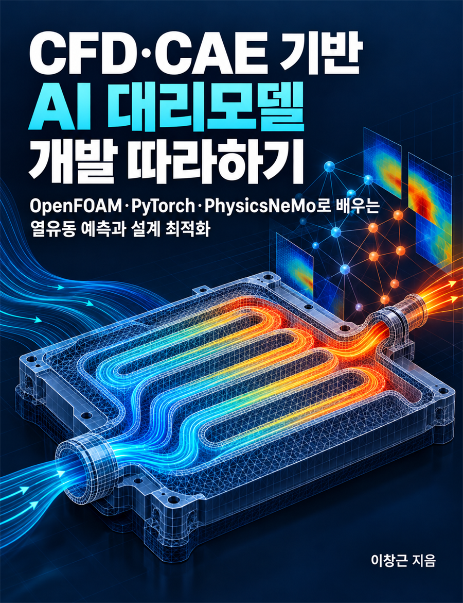

# cfd-tutorial

위키독스 책 **《CFD·CAE 기반 AI 대리모델 개발 따라하기》 — OpenFOAM·PyTorch·PhysicsNeMo로 배우는 열유동 예측과 설계 최적화**의 예제 코드 저장소입니다.

<a href="https://wikidocs.net/book/21879"></a>

- 위키독스: https://wikidocs.net/book/21879

## 검증 기준

| 항목 | 버전 |
|---|---|
| OS | Ubuntu 22.04 (Windows는 WSL2 Ubuntu) |
| OpenFOAM | Foundation 판 14 (apt 패키지 openfoam14 20261008) |
| Python | 3.12 (uv 0.13로 설치·관리) |
| PyTorch | 2.14.1 (CUDA 13.0 빌드) |
| GPU | NVIDIA RTX 3090 24GB, 드라이버 580 (CPU만으로 실행 가능한 장은 각 장 README에 표시) |

Python 패키지 버전은 `pyproject.toml`과 `uv.lock`으로 고정합니다. 책의 각 페이지 상단에도 그 페이지를 실행한 버전을 적습니다.

## 빠른 시작

```bash
git clone https://github.com/ady95/cfd-tutorial.git
cd cfd-tutorial
uv sync        # .python-version(3.12)과 uv.lock 그대로 설치
uv run python -c "import torch; print(torch.cuda.is_available())"
```

설치 과정과 문제 해결은 책 02-1과 [environment](environment) 폴더를 참고하세요.

## 실습 폴더

장별 폴더는 해당 장을 집필하면서 추가합니다.

| 장 | 폴더 | 내용 | 공개 |
|---|---|---|---|
| 2장 | ch02 | 2D 채널 유동 OpenFOAM 케이스, 격자 독립성 검사 | 1차 |
| 3장 | ch03 | 냉각 채널 파라미터화 케이스, Python 실행 자동화 | 1차 |
| 4장 | ch04 | LHS 샘플링, 배치 시뮬레이션, 데이터셋 구축 | 1차 |
| 5장 | ch05 | 기준선 회귀, XGBoost, PyTorch MLP, Optuna | 1차 |
| 6장 | ch06 | 오차 지표, 데이터 분리, OOD 평가, 총비용 측정 | 1차 |
| 7장 | ch07 | FNO 물리장 예측 (neuraloperator) | 2차 |
| 8장 | ch08 | PhysicsNeMo 예제와 적용 | 2차 |
| 9장 | ch09 | 물리 손실 결합 학습 | 2차 |
| 10장 | ch10 | Optuna·BoTorch 다목적 최적화, CFD 재검증 | 1차 |
| 11장 | ch11 | 불확실성 추정, Active Learning 루프, 설계 범위 확장 | 2차 |
| 12장 | ch12 | 통합 파이프라인, 예측 API | 1차 |

## 재현성 원칙

- 난수 시드와 학습·검증·OOD 데이터 분할을 코드에 고정합니다.
- 대규모 CFD 원본 결과는 저장소에 넣지 않습니다. 대신 같은 결과를 다시 만드는 스크립트와 작은 예제 데이터를 제공합니다.
- CFD 계산 시간과 학습 시간은 CPU·GPU 종류에 따라 달라집니다. 책에 실은 시간은 측정 환경과 함께 읽어 주세요.
